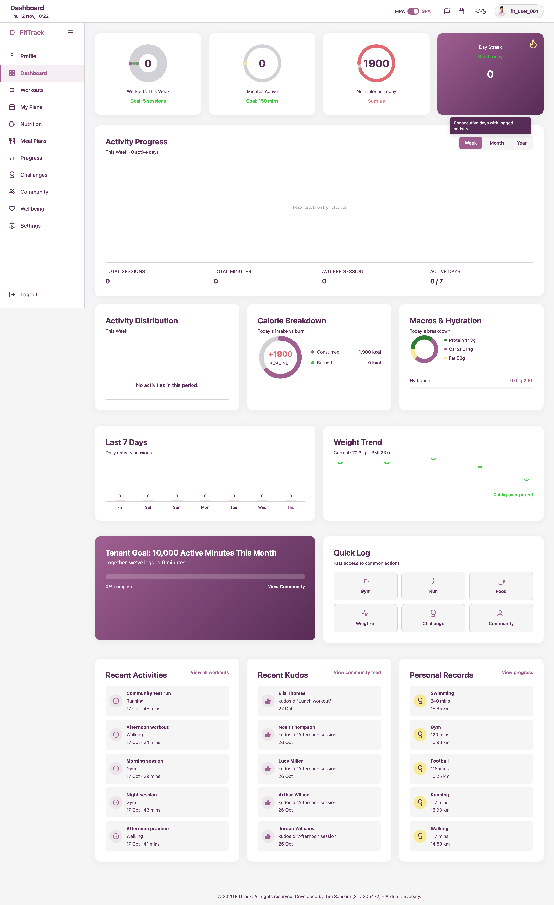
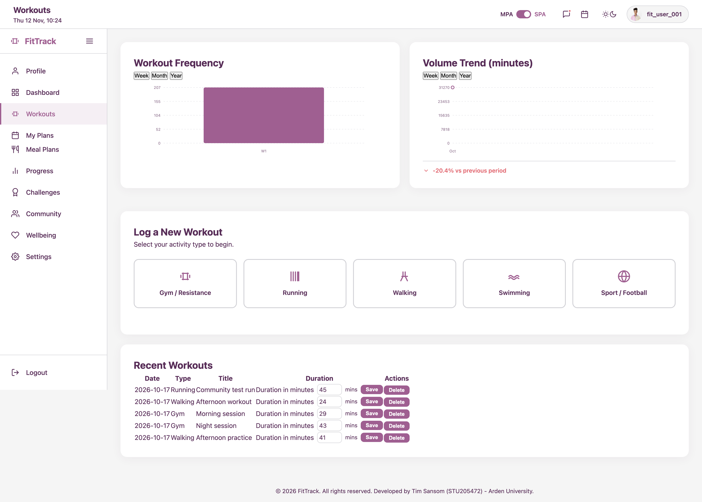
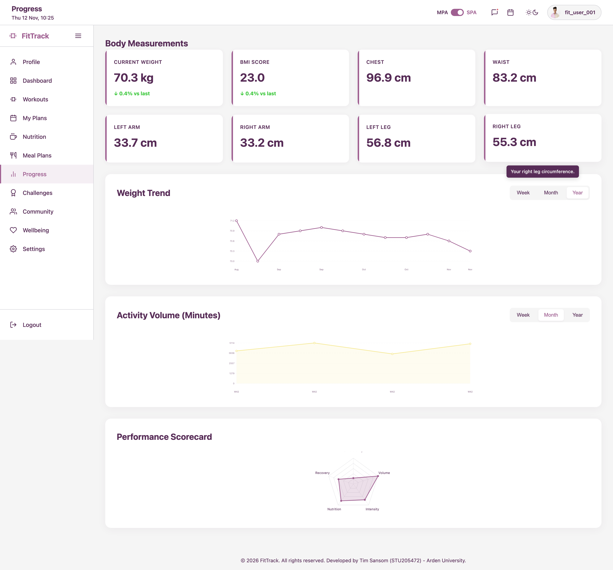
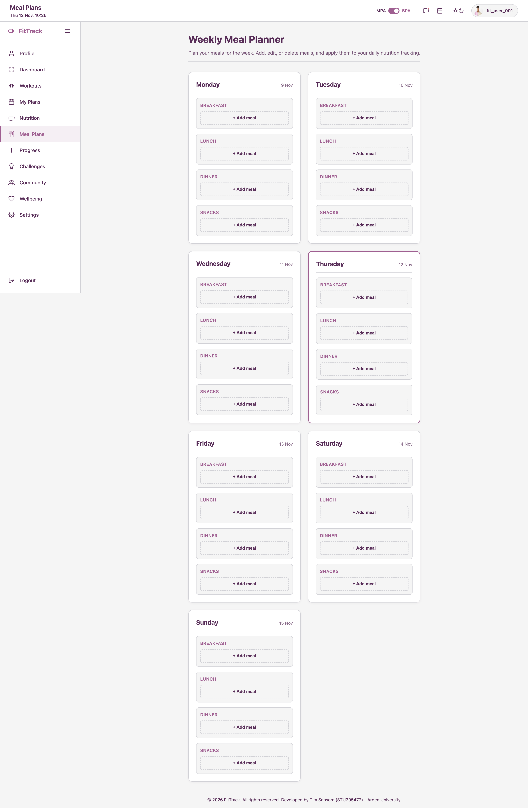

# FitTrack: Hybrid Multi-Tenant Wellbeing Platform

<div align="center">


**A production-grade, multi-tenant physical wellbeing tracking system engineered entirely with vanilla technologies. No frameworks. No compromises.**

[Features](#-features) • [Visual Showcase](#-visual-showcase) • [Quick Start](#-quick-start) • [Architecture](#-architecture) • [Security](#-security)

</div>

---

## 🖼️ Visual Showcase

<div align="center">

<details>
<summary><strong>Click to expand the application gallery</strong></summary>
<br>

<table>
  <tr>
    <td align="center">
      
      <br><em>Command Centre Dashboard with custom SVG analytics</em>
    </td>
  </tr>
  <tr>
    <td align="center">
      
      <br><em>Workout logging with time-range analytics and CRUD operations</em>
    </td>
  </tr>
  <tr>
    <td align="center">
      
      <br><em>Body measurements and performance scorecards</em>
    </td>
  </tr>
  <tr>
    <td align="center">
      
      <br><em>Weekly meal planning and nutrition management</em>
    </td>
  </tr>
</table>

</details>

</div>

---

## ✨ Features

### 🏗️ Hybrid Architecture
- **Multi-Page Application (MPA):** Server-side rendering for authentication, tenant management, and administrative operations.
- **Single Page Application (SPA):** Client-side routing with a custom Vanilla JavaScript router for seamless dashboard interactions and real-time data visualisation.

### 🔒 Enterprise-Grade Security
- Prepared statements (PDO) preventing SQL injection.
- CSRF token validation on all state-changing operations.
- XSS prevention through strict output escaping.
- Custom rate-limiting middleware.
- Multi-tenant data isolation enforced at the database schema level.

### 📊 Advanced Data Visualisation
- Custom SVG charting engine (zero external libraries).
- Interactive progress rings, radial gauges, and GitHub-style contribution heatmaps.
- Time-series analytics with weekly, monthly, and yearly views.

### 🏋️ Comprehensive Tracking
- **Workouts:** Gym sessions (with detailed sets/reps), running, swimming, walking, and sports.
- **Nutrition:** Calorie tracking, macronutrient breakdown, and weekly meal planning.
- **Progress:** Body measurements, weight trends, and BMI tracking.
- **Community:** Activity feeds, kudos system, and tenant-wide goals.

---

## 🚀 Quick Start

### Prerequisites
- Docker & Docker Compose (v2.0+) **OR** PHP 8.4+, MariaDB 11.4+, and Apache/Nginx.

### Option 1: Docker (Recommended) ⚡

**1. Clone the repository:**
```bash
git clone https://github.com/Tim-sansom/fittrack.git
cd fittrack